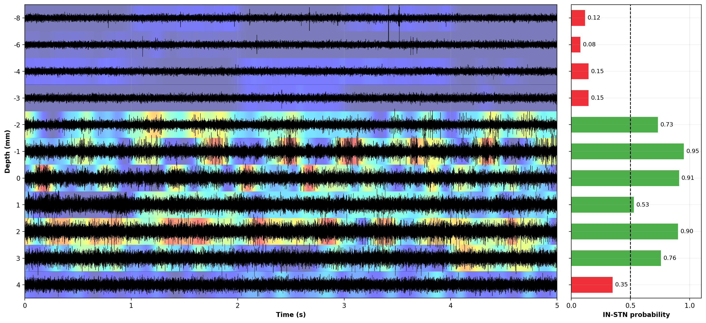

# XAI-STIM: eXplainable Artificial Intelligence for SubThalamic nucleus Intraoperative Mapping

<p align="center">
  
</p>

Deep Brain Stimulation (DBS) of the Subthalamic Nucleus (STN) is an effective treatment for motor symptoms in people with Parkinson's disease. Accurate placement of the stimulating electrode is essential for obtaining the best therapeutic outcome. During surgery, Microelectrode Recordings (MERs) provide neurophysiological information that helps clinicians identify whether the electrode is inside or outside the STN.

`XAI-STIM` is a deep-learning pipeline for classifying MERs as **inside the STN** or **outside the STN**. The model combines convolutional patch encoding, multi-head self-attention, and a multilayer perceptron. One-dimensional Grad-CAM maps provide explanations of the model predictions and can be reviewed together with the MER trajectories.

## What `XAI-STIM` does

1. Loads a NumPy signal matrix (`.npz`) and its metadata table (`.csv`).
2. Prepares each MER using the pipeline described in [1]:
   - resampling to 10 kHz;
   - division into one-second windows;
   - z-score normalization;
   - 200 Hz high-pass filtering;
   - notch filtering at higher harmonics of 50 Hz.
3. Classifies each window as outside-STN (`0`) or inside-STN (`1`).
4. Computes class probabilities and classification metrics.
5. Generates one-dimensional Grad-CAM relevance maps.
6. Exports figures and provides an interactive tool for explanations validation.

## Quick start

The complete sample workflow is available in [`main.ipynb`](main.ipynb). It uses the included [`sample_data.npz`](sample_data.npz), [`sample_meta.csv`](sample_meta.csv), and trained model.

Python 3.12 is supported. To install the pinned requirements, run:

```bash
python -m pip install -r requirements.txt
```

Run the notebook cells in order. The notebook performs:

```text
data import
    ↓
resampling and filtering
    ↓
one-second windowing and inference
    ↓
1D Grad-CAM generation
```

The resulting figures are written to `results/main_figures/`:

- `01_raw_signals.png`
- `02_processed_signals.png`
- `03_inference.png`
- `04_gradcam.png`

Inference automatically uses CUDA when a compatible GPU is available and otherwise runs on the CPU.

## Repository structure

```text
XAI-STIM/
├── main.ipynb
├── requirements.txt
├── sample_data.npz
├── sample_meta.csv
├── modules/
│   ├── 01_data_preparation/
│   │   ├── import_datasets.py
│   │   ├── compute_overlap.py
│   │   ├── processing.py
│   │   └── split_data.py
│   ├── 02_XAI-STIM/
│   │   ├── xai_stim.py
│   │   ├── inference.py
│   │   ├── gradcam1D.py
│   │   ├── compute_performances.py
│   │   └── trained_models/
│   │       ├── all_in_one.pt
│   │       ├── leave_AlphaMap_out.pt
│   │       ├── leave_LeadPoint_out.pt
│   │       └── leave_NeuroSet_out.pt
│   └── 03_expert_validation/
│       ├── traj2json.py
│       ├── sample_data.json
│       └── XAI_STIM_validation_tool.html
├── results/
│   ├── overlap.csv
│   ├── AiO_data_split.csv
│   ├── all_in_one.csv
│   ├── leave_LeadPoint_out.csv
│   ├── leave_NeuroSet_out.csv
│   ├── leave_AlphaMap_out.csv
│   └── main_figures/
└── README.md
```

## Files description

### Release scope

This repository is intended to support **checkpoint-based result replication**: it distributes trained XAI-STIM checkpoints and utilities for data preparation, inference, performance evaluation, Grad-CAM generation, and expert-review data collection.

### Sample workflow

- `main.ipynb`: complete demonstration of data import, resampling and filtering, window-level inference, probability-by-depth visualization, and Grad-CAM generation.
- `sample_data.npz`: MER signals from a representative patient hemisphere, stored as rows of a zero-padded matrix.
- `sample_meta.csv`: metadata associated with the sample recordings.

### Data preparation

- `import_datasets.py`: downloads and standardizes the *LeadPoint*, *NeuroSet*, and *AlphaMap* datasets into paired NPZ/CSV files.
- `compute_overlap.py`: calculates patient- and class-specific window overlaps to balance the number of training examples within patients and across datasets.
- `processing.py`: contains signal-loading, resampling, windowing, normalization, high-pass, and notch-filtering functions. Its normalization and filtering functions accept individual recordings or row-wise matrices of any non-zero sample length.
- `split_data.py`: organizes processed patient folders into the all-in-one training, validation, and test partitions defined in `results/AiO_data_split.csv`.

### Classification and explainability

- `xai_stim.py`: defines the XAI-STIM neural-network architecture.
- `inference.py`: splits a complete 10 kHz recording into one-second windows with a configurable overlap (50% by default), applies the model preprocessing, loads a trained checkpoint, and returns one probability pair per window. It also supports matrices of prepared windows for batch validation exports.
- `gradcam1D.py`: computes one-dimensional Grad-CAM maps and provides the trajectory plotting function used by the sample notebook.
- `compute_performances.py`: computes overall and patient-wise AUC, F1 score, sensitivity, and specificity from prediction tables.
- `trained_models/`: contains the all-in-one checkpoint and the three leave-one-dataset-out checkpoints.

### Expert validation

- `traj2json.py`: converts an NPZ/CSV trajectory pair into the signal, prediction, and saliency JSON format required by the validation interface.
- `XAI_STIM_validation_tool.html`: browser-based interface for loading trajectories, reviewing model explanations, annotating STN-typical regions, and exporting expert responses to Likert-scale questionnaires.
- `sample_data.json`: ready-to-load example for the validation interface.

### Results

- `overlap.csv`: patient- and class-specific overlap values used for one-second window extraction.
- `AiO_data_split.csv`: patient allocation and window counts for the all-in-one experiment.
- `all_in_one.csv`: patient-wise all-in-one validation results.
- `leave_<dataset_name>_out.csv`: patient-wise leave-one-dataset-out validation results.
- `main_figures/`: figures generated by the sample notebook.

## Preparing custom data

Each trajectory requires one `.npz` signal file and one `.csv` metadata file with matching names or explicitly supplied paths.

### Signal matrix

The NPZ file must contain a two-dimensional matrix with shape `N × M`, where:

- `N` is the number of MERs;
- `M` is the length of the longest MER in samples;
- each MER occupies one row;
- shorter recordings are zero-padded to `M`;
- the unpadded length is stored in the metadata `length` column.

### Metadata

The CSV file must contain one row per signal and the following columns:

- `patient`: patient identifier, for example `P018`;
- `side`: hemisphere, `LEFT` or `RIGHT`;
- `dataset`: dataset name used to infer the original sampling frequency;
- `depth`: estimated distance from target in micrometres;
- `electrode`: recording electrode identifier;
- `length`: signal length in samples before zero-padding;
- `class`: reference label, with `0` for outside-STN and `1` for inside-STN.

Example:

```csv
patient,side,dataset,depth,electrode,length,class
P018,LEFT,NeuroSet,-8000,Electrode1,100000,0
P018,LEFT,NeuroSet,-2000,Electrode1,100000,1
P018,LEFT,NeuroSet,4000,Electrode1,100000,0
```

The predefined dataset sampling frequencies are:

| Dataset | Sampling frequency |
|---|---:|
| LeadPoint | 24 kHz |
| NeuroSet | 20 kHz |
| AlphaMap | 12 kHz |

All signals are resampled to 10 kHz before classification.

## Python examples

Add the modules paths:

```python
from pathlib import Path
import sys

root = Path("path/to/XAI-STIM")
sys.path.insert(0, str(root / "modules" / "01_data_preparation"))
sys.path.insert(0, str(root / "modules" / "02_XAI-STIM"))
```

### Classification

Pass a single recording sampled at 10 kHz to `inference`. It creates complete one-second windows, applies the preprocessing internally, and returns one class-probability pair per window. Set `overlap` to the fraction shared by consecutive windows; the default is `0.0` (0%).

```python
from processing import load_matrix
from inference import inference

recording = load_matrix(root / "path" / "to" / "recording_10khz.npz")[0]
probabilities, starts = inference(
    recording,
    overlap=0.5,
    return_window_starts=True,
)
predicted_classes = probabilities.argmax(axis=1)
```

### Grad-CAM

`gradcam1D` accepts complete recordings and resamples them when necessary:

```python
from gradcam1D import gradcam1D

signals = load_matrix(root / "sample_data.npz")
maps, probabilities = gradcam1D(
    signals,
    sampling_frequency=20000,
    target_class=1,
    return_probabilities=True,
)
```

For the complete, executable workflow and plotting code, refer to `main.ipynb`.

## Expert-validation interface

Generate a validation trajectory from the sample files with:

```bash
python modules/03_expert_validation/traj2json.py
```

Then open `modules/03_expert_validation/XAI_STIM_validation_tool.html` in a web browser and select the generated JSON file. The interface supports trajectory review, manual annotation of STN-typical regions, comparison with Grad-CAM explanations, and JSON export of the expert responses.

# Citation

If you use `XAI-STIM` in your research, please cite the accompanying XAI-STIM publication. The complete bibliographic reference and DOI will be added upon publication.

[1] Sciscenti, F., Agostini, V., Rizzi, L., Lanotte, M., & Ghislieri, M. *Interpretable Deep Learning for SubThalamic Nucleus Targeting from Microelectrode Recordings: A Multicentre Cross-Dataset Study* - *submitted for publication*

[2] Sciscenti, F., Agostini, V., Rizzi, L., Lanotte, M., Ghislieri, M. (2026). *Validation of an Interpretable AI System for Localizing the SubThalamic Nucleus During DBS Neurosurgery*. Artificial Intelligence in Medicine (AIME) 2026. https://doi.org/10.1007/978-3-032-30710-1_30

# Data and code availability

The code and checkpoints in this repository support evaluation and explanation workflows with the released models. The open datasets used by the project are available at:

[3] Sciscenti, F., Agostini, V., Rizzi, L., Lanotte, M., & Ghislieri, M. (2026). *ML-STIM: Machine Learning for SubThalamic nucleus Intraoperative Mapping* [Dataset]. Zenodo, v2. https://doi.org/10.5281/zenodo.23259894

[4] Ciecierski, K., Mandat, T. (2023). *RAW Deep Brain Stmulation Recordings* [Dataset]. Mendeley Data, v1. https://doi.org/10.17632/tr93krswn2.1

## Contributing

Contributions are welcome. When reporting a bug, please include:

1. A concise and descriptive title.
2. Your operating system and Python version.
3. Whether `main.ipynb` runs successfully with the included sample data.
4. The complete error message and the pipeline step where it occurred.

## Contacts

**Fabrizio Sciscenti**, Ph.D. Candidate — [H-MoVe](https://www.polito.it/en/staff?p=fabrizio.sciscenti)  
[@FabrizioSciscenti](https://www.linkedin.com/in/fabrizio-sciscenti-250573311) — fabrizio.sciscenti@polito.it

**Marco Ghislieri**, Ph.D. — [H-MoVe](https://www.polito.it/en/staff?p=marco.ghislieri)  
[@MarcoGhislieri](https://www.linkedin.com/in/marco-ghislieri/) — marco.ghislieri@polito.it
