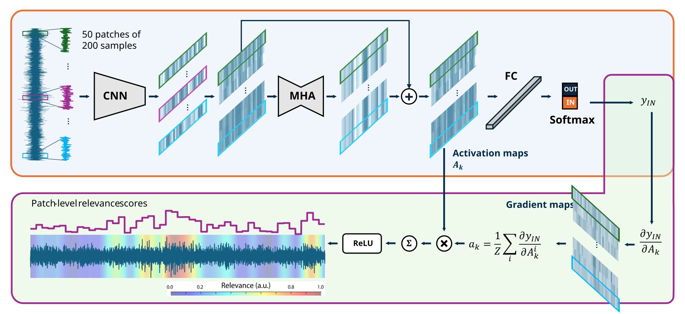

# XAI-STIM
EXplainable Artificial Intelligence for SubThalamic nucleus Intraoperative Mapping

<p align="center">
  
</p>

Code for *Interpretable Deep Learning for SubThalamic Nucleus Targeting from Microelectrode Recordings: A Multicentre Cross-Dataset Study*.

XAI-STIM classifies 1-second microelectrode-recording segments as inside or outside the subthalamic nucleus. The repository contains the proposed pipeline: preprocessing, patient-wise AiO and LODO protocols, model training, patient-level evaluation, and one-dimensional Grad-CAM.

## Scope

The manuscript uses 168 patients from three public datasets:

| Dataset | Patients | Original sampling rate |
| --- | ---: | ---: |
| LeadPoint | 46 | 24 kHz |
| NeuroSet | 36 | 20 kHz |
| AlphaMap | 86 | 12 kHz |

Dataset-specific download and conversion adapters are intentionally deferred until the public archives and their exact layouts are finalized. The required interim format is described in [docs/data_format.md](docs/data_format.md).

## Installation

Python 3.10 is the manuscript environment.

```bash
conda env create -f environment.yml
conda activate xai-stim
pip install -e .
```

For an exact pip environment, use `requirements-lock.txt`.

## Reproduction workflow

1. Arrange the three datasets in the canonical local format under `data/raw/`.
2. Prepare harmonized 1-second segments:

   ```bash
   python scripts/prepare_data.py --raw data/raw --output data/processed
   ```

3. Reproduce the AiO experiment:

   ```bash
   python scripts/train_aio.py
   python scripts/evaluate_xai_stim.py
   ```

4. Reproduce the three LODO experiments:

   ```bash
   python scripts/train_lodo.py --config configs/lodo_leadpoint.yaml
   python scripts/evaluate_xai_stim.py --training-config configs/lodo_leadpoint.yaml
   python scripts/train_lodo.py --config configs/lodo_neuroset.yaml
   python scripts/evaluate_xai_stim.py --training-config configs/lodo_neuroset.yaml
   python scripts/train_lodo.py --config configs/lodo_alphamap.yaml
   python scripts/evaluate_xai_stim.py --training-config configs/lodo_alphamap.yaml
   ```

Run all four training configurations with:

```bash
python scripts/reproduce_xai_stim_results.py
```

The AiO patient assignments in `configs/aio.yaml` are the assignments used by the source pipeline. LODO keeps the held-out dataset entirely unseen and selects validation patients independently within each development dataset.

## Expected XAI-STIM results

Patient-level mean ± standard deviation reported in the manuscript:

| Protocol | Test domain | AUC | F1-score | Sensitivity | Specificity |
| --- | --- | ---: | ---: | ---: | ---: |
| AiO | Overall | 92.2 ± 6.4% | 83.0 ± 12.3% | 82.0 ± 15.7% | 86.0 ± 11.2% |
| LODO | LeadPoint | 83.7 ± 8.6% | 74.4 ± 8.9% | 89.8 ± 12.8% | 48.6 ± 13.7% |
| LODO | NeuroSet | 90.3 ± 7.3% | 78.7 ± 16.8% | 75.3 ± 19.6% | 86.1 ± 8.9% |
| LODO | AlphaMap | 90.3 ± 12.3% | 56.5 ± 35.4% | 49.9 ± 35.5% | 96.0 ± 6.6% |

## Explainability

`scripts/generate_gradcam.py` computes one-dimensional Grad-CAM for the IN-STN logit from the attention output. It creates sample-level maps, combines long recordings window-by-window, applies Gaussian smoothing with σ = 500 samples, and probability-weights the result as in the supplied inference workflow. `scripts/analyse_xai_validation.py` computes DSC at the manuscript's 15% threshold and AUmC. No other saliency method or statistical analysis is included.

## Repository map

- `configs/`: manuscript experiment configurations.
- `src/xai_stim/`: data, model, training, evaluation, and explainability code.
- `scripts/`: command-line reproduction entry points.
- `docs/`: data contract and protocol details.
- `data/`: documentation and generated split manifests only; recordings are ignored.
- `results/`: generated outputs only.
- `tests/`: lightweight behavioral tests.

Development-variant reconciliation is recorded in [docs/reproducibility_notes.md](docs/reproducibility_notes.md).

## Citation

Citation metadata is provided in [CITATION.cff](CITATION.cff). Update the provisional publication fields when the article receives its final bibliographic record.

## License

Code is released under the MIT License. Dataset licenses and terms remain those of the original providers.

